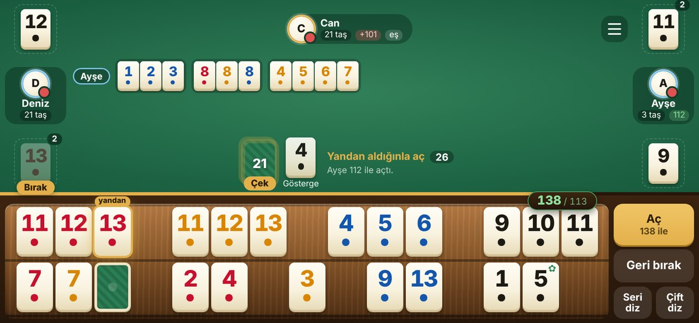
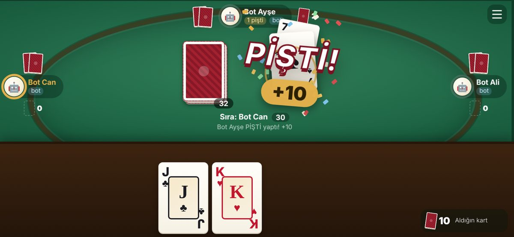
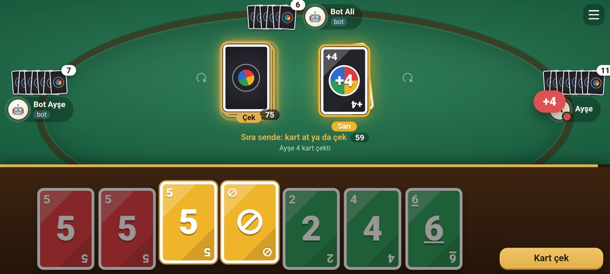
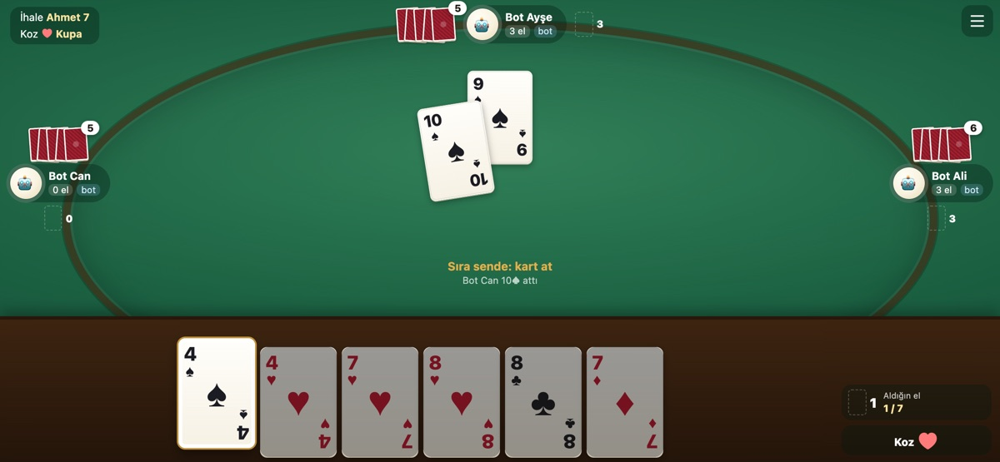
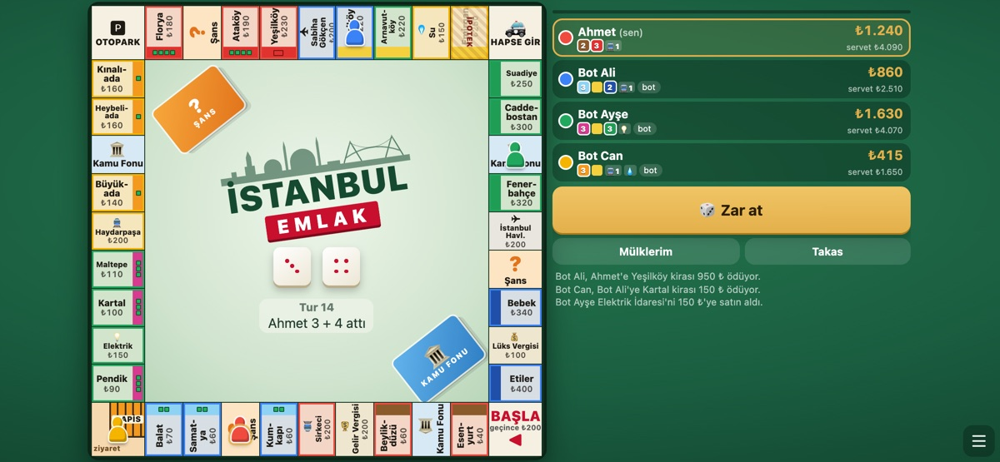

# 101 Okey · Okey · Pişti · Batak · Renk · İstanbul Emlak

Arkadaşlarla telefondan oynanan masa oyunları: **101 Okey**, **Okey** (101 olmayan klasik okey), **Pişti**, **Batak** (4 kişilik ihaleli ve eşli, 3 kişilik gömmeli), **Renk** ve İstanbul semtleriyle oynanan emlak ticareti oyunu **İstanbul Emlak**. Hangi oyunun oynanacağı ana menüden (lobi) seçilir. Masayı bir bilgisayar (Mac, Windows ya da Linux) **ya da Android telefon** açar; herkes telefonundan ya da tabletinden **tarayıcıyla** girer. Android, iPhone, tablet ve bilgisayar aynı masada oynar.

**Android uygulaması** ile bilgisayara gerek kalmaz: bir telefon **Masa kur** der, diğer Android'ler **Arkadaşına bağlan** ile listeden masayı seçer, iPhone'lular QR kodu okutup tarayıcıdan girer. Ayrıntı: [Android uygulaması](#android-uygulaması).



| Pişti | Renk |
| --- | --- |
|  |  |
| **Batak** | **İstanbul Emlak** |
|  |  |

## Özellikler

- **Her ağdan oynanır:** internet linkiyle herkes kendi yerinden girer; biri evin Wi-Fi'ında, biri hotspot'ta, biri mobil veride olabilir. İsterseniz internetsiz, aynı Wi-Fi'dan da oynanır.
- **QR kodla giriş:** bilgisayardaki sayfada çıkan kodu telefon kamerasıyla okutmak yeter.
- **Altı oyun:** ana menüde **101 Okey**, **Okey**, **Pişti**, **Batak**, **Renk** ya da **İstanbul Emlak** seçilir. Okeyler 4 kişiyle, Batak 4 kişiyle (gömmeli 3 kişiyle), Pişti, Renk ve Emlak 2-4 kişiyle oynanır.
- **Botlar:** istediğiniz sandalyeye **bot koy** ile bot oturur, botlar kendiliğinden oynar. Sonradan gelen arkadaş bir botun yerine geçer.
- **Karşılıklı masa:** pişti ve renk oyununda kartlar oval bir masada dağıtılır, atılan kartlar uçarak gider. Pişti yapınca ekrana büyük **PİŞTİ!** yazısı, konfeti ve titreşim gelir; renk oyununda yön oku, SON! ve Yakala! düğmeleri var.
- **Oyun modları:** 101'de eşli / eşsiz, katlamalı (eşine katlanmaz), el sayısı; okeyde eşli / eşsiz, başlangıç puanı ve gösterge; piştide eşli / eşsiz ve hedef puan; batakta tür (ihaleli, eşli, gömmeli) ve el sayısı; renk oyununda hedef puan ve +2/+4 biriktirme; emlakta başlangıç parası, tur sınırı ve otopark kumbarası. Hepsinde hamle süresi (20–60 sn ya da süresiz).
- **İstanbul Emlak:** 40 karelik tahtada 22 İstanbul semti, 4 istasyon/havalimanı, 2 idare, Şans ve Kamu Fonu kartları. Semt fiyatları gerçek konut m² fiyatlarına göre (Etiler en pahalı, Esenyurt en ucuz). Zarlar yuvarlanır, piyonlar kare kare yürür, tapu kartları, açık artırma, ev/otel, ipotek ve takas var.
- **Kolay ıstaka:** dizili perlerin toplamı ıstakanın köşesinde yazar; yetince tek dokunuşla açılır. "Seri diz" ve "Çift diz" perler arasında boşluk bırakarak dizer. Açtıktan sonra elde kalan puan, sol üstte toplam puanın görünür.
- **İşle düğmesi:** işlenebilen taşlar işaretlenir, tek dokunuşla masaya işlenir; masadaki okey alınabiliyorsa onu da alır.
- **Kopmaya dayanıklı:** telefonun bağlantısı koparsa kendiliğinden yeniden bağlanır. Oyun kapanıp açılsa da kaldığı yerden devam eder.
- **Masa dolu kalmaz:** sayfayı kapatıp giden birinin yeri, masaya oturmadan da **çıkar** ile boşaltılır; lobide 3 dakika bağlı olmayan kendiliğinden kalkar. Oyun sürerken bağlantısı kopanın yerine **bot koy**ulur ya da yeni gelen **yerine geç**er.
- **Kurallar oyunda kontrol edilir:** açış puanı, işleme, okey ve ceza puanları, el sonu hesabı.
- **Kurulum derdi yok:** sadece Node.js gerekir; `npm install` yok, ek paket yok.

## Android uygulaması

Google Play'de **101 Okey · Pişti** (paket adı `ahmetemreozumagi.okeypisti`) ya da [android/README.md](android/README.md) içinde anlatıldığı gibi APK olarak kurulur. İnternet gerekmez; herkes aynı Wi-Fi'da ya da birinin hotspot'unda olmalı.

- **Masa kur:** oyun bu telefonda çalışır, kuran da aynı telefondan oynar. Lobide arkadaşlar için adres ve QR kod görünür; iPhone'lular ve bilgisayarlar tarayıcıdan bu adrese girer.
- **Arkadaşına bağlan:** aynı ağda masa açmış telefonlar listelenir, dokununca bağlanılır. Liste boş kalırsa uygulama ağı tarar; adres elle de yazılabilir.
- Masa açıkken ekran kapanmaz. Masayı kuran uygulamadan çıkarsa masa kapanır (önce uyarır); oyun kaydedilir, tekrar "Masa kur" deyince kaldığı yerden devam eder.
- Oyun kuralları ve arayüz web sürümüyle birebir aynıdır: uygulama bu depodaki JS dosyalarını paketler (`android/` klasörü).

## Gereken

- **Oyunu açacak bilgisayarda Node.js** (ücretsiz, bir kere kurulur): [nodejs.org](https://nodejs.org) adresinden **LTS** sürümünü indirip kurun.
- **Oyuncularda sadece bir tarayıcı** (Chrome, Safari, Samsung Internet...).

## Kurulum

**Kolay yol:** bu sayfada yeşil **Code** düğmesi → **Download ZIP**, sonra zip'i açın. Klasörün adı `Okey_101-main` olur.

**Git ile:**

```
git clone https://github.com/AhmetEmreOzumagi/Okey_101.git
cd Okey_101
```

## Başlatma

1. Oyun klasöründe bir terminal açın:
   - **Windows:** klasörü açın, üstteki adres çubuğuna `cmd` yazıp Enter'a basın.
   - **Mac:** Terminal'i açın, `cd ` yazın (sonunda bir boşluk), klasörü Terminal penceresine sürükleyip Enter'a basın.
2. Şunu yazın:

   ```
   node baslat.js link
   ```

3. Bilgisayarda oyun sayfası açılır, birkaç saniye içinde internet linkinin **QR kodu** çıkar. Arkadaşlarınız kodu okutur ya da linki WhatsApp'tan atarsınız.
4. Herkes adını yazıp masada boş bir sandalyeye dokunur. Üstten oyunu (**101 Okey**, **Okey**, **Pişti**, **Batak**, **Renk**, **Emlak**) ve ayarları seçin, sonra **Oyunu başlat**. Az kişiyseniz istediğiniz sandalyeye **bot koy** ya da **Boş yerlere bot oturt**.

Pencere açık kaldıkça oyun ve link çalışır. Kapatınca oyun durur; tekrar açınca kaldığı yerden devam eder.

| Komut | Ne zaman |
| --- | --- |
| `node baslat.js link` | **En kolayı.** Herkes her ağdan girer, aynı Wi-Fi şart değil. İnternet gerekir. |
| `node baslat.js` | Herkes aynı Wi-Fi'dayken, internetsiz. Telefonlar bilgisayarın yerel adresine girer (örn. `192.168.1.34:8101`). |

`npm run link` ve `npm start` de aynı işi yapar. Diğer seçenekler: `--port 9000` (başka port), `--tarayici-acma` (bilgisayarda sayfayı açma).

### Çift tıklayarak

Terminal istemeyenler için klasörde hazır dosyalar var:

| | İnternet linkiyle | Aynı Wi-Fi'dan |
| --- | --- | --- |
| **Windows** | `Windows - Internetten Oyna.bat` | `Windows - Oyunu Baslat.bat` |
| **Mac** | `Mac - Internetten Oyna.command` | `Mac - Oyunu Baslat.command` |

Windows'taki dosyalar Node.js kurulu değilse kurmayı da teklif eder. Mac'te **Mac - Guncelle.command** oyunu GitHub'daki en yeni sürüme günceller (oyun kaydı kalır) ve internet linkiyle açar. İnternetten indirilen dosyaları sistem ilk seferde engelleyebilir:

- **Windows** "Windows bilgisayarınızı korudu" derse **Ek bilgi → Yine de çalıştır**; "Yayımcı doğrulanamadı" derse **Çalıştır**.
- **Mac** dosyayı açmazsa klasörde açtığınız terminalde bir kere `xattr -cr . && chmod +x *.command` çalıştırın, ya da doğrudan `node baslat.js link` kullanın.

## Oyun içinde

- Telefonu yan çevirin. Menüden (☰) **Tam ekran** seçilebilir. iPhone'da tam ekran için Safari'de **Paylaş → Ana Ekrana Ekle**, sonra ana ekrandaki simgeden açın.
- **Çekmek:** desteye dokunun ya da soldaki oyuncunun attığı taşa dokunup alın. Yandan aldığınız taşla açamazsanız **Geri bırak**.
- **Dizmek:** taşı sürükleyerek ıstakada yerini değiştirin ya da **Seri diz** / **Çift diz**.
- **Açmak:** ıstakanın sağ üstündeki toplam yetince yeşil olur (ör. `108 / 101`); **Aç**'a basınca dizili perlerin hepsi birden açılır. Açtıktan sonra **İndir** yeni dizdiğiniz perleri masaya koyar.
- **İşlemek:** **İşle** düğmesi (Seri diz'in yanında) işlenebilen bütün taşları kendiliğinden doğru perlere koyar; ıstakada dizili perleriniz İndir için kalır. Tek tek işlemek için taşı masadaki pere sürükleyin ya da taşı seçip pere dokunun. İşlenebilen ya da masadaki okeyi alabilen taşların altında yeşil bir çizgi olur.
- **Masadaki okeyi almak:** okeyin yerine geçen taş sizdeyse onu o pere sürükleyin ya da **İşle**'ye basın; okey elinize gelir. Soldan böyle bir taş gelirse alıp hemen okeyi alabilirsiniz. 3'lü gruptaki okey için eksik iki rengin ikisi de gerekir (ör. kırmızı 13, sarı 13 ve okey varsa mavi 13 ile siyah 13); İşle ikisini birden koyup okeyi alır.
- **Atmak:** taşı sağ alttaki **At** kutusuna sürükleyin ya da seçip **At**.
- Okey elinizde de masadaki perlerde de ters (yeşil sırtı görünür) durur; sahte okey sadece ✿ işaretiyle görünür. Ortada sadece gösterge vardır. Kimin elinde kaç taş kaldığı görünmez.
- Süre dolarsa taş otomatik çekilip atılır.
- Telefon kapanırsa sayfayı yenileyin; başka telefona geçtiyseniz aynı adı yazmanız yeterli. Bağlanma adresi ve QR kod menüde (☰) de var.
- **Masa doluysa:** lobide bağlantısı olmayan birinin ya da botun altındaki **çıkar**'a dokunun (masaya oturmadan da olur), boşalan yere oturun. Lobide 3 dakikadır bağlı olmayan zaten kendiliğinden kalkar.
- **Oyun sürerken biri giderse:** menüden (☰) **"… yerine bot koy"** deyin, bot onun eliyle devam eder. Yeni gelen biri adını yazıp bağlantısı kopanın ya da botun altındaki **yerine geç**'e dokunarak onun yerinden oynar.

### Okey'de (101 olmayan)

- Istaka, çekme, dizme ve atma 101'deki gibidir; masaya per açılmaz.
- 15. taşınızı atarken kalan 14 taş seri/grup ya da 7 çift olunca **Bitir**'e basın (ya da taşı ortadaki desteye sürükleyin). Istakanın sağ üstünde kaç taşın dizili olduğu yazar (ör. `11 / 14`).
- Göstergenin eşi elinizdeyse ilk hamlenizde **Göstergeyi göster** bağlantısı çıkar.

### Pişti, Batak ve Renk'te

- Telefon yan da dik de tutulabilir. Kendi kartlarınız altta, rakipler masanın etrafında oturur.
- **Kart atmak:** karta iki kez dokunun, ya da bir kez dokunup ortadaki yığına dokunun, ya da kartı yukarı, masaya sürükleyin.
- **Renk:** atacak kartınız yoksa desteye ya da **Kart çek**'e dokunun; çektiğiniz kart uyuyorsa atabilir ya da **Pas** diyebilirsiniz. Renk kartında renk seçme penceresi açılır. 2 kart kalınca **SON!**'a basın; biri demeyi unutursa **Yakala!** düğmesi çıkar.
- **Batak:** ihale sırası size gelince ortada sayılar çıkar; birine ya da **Pas**'a dokunun. İhaleyi alırsanız kozu seçersiniz; gömmelide önce gömülecek 4 kartı seçip **Göm**'e basarsınız. Atılamayacak kartlar soluk görünür. Eşlide eşinizin açık eli ortada durur; sırası gelince onun kartına dokunarak oynarsınız.
- El bitince sonuç tablosu gelir: piştide kart, kart puanı, pişti ve çoğunluk puanları; batakta ihale ve alınan eller; renk oyununda herkesin elinde kalan kartlar.

### İstanbul Emlak'ta

- Telefon yan da dik de tutulabilir. Sıranız gelince **Zar at**; piyonunuz kare kare yürür.
- Sahipsiz bir mülke gelince tapu kartı açılır: **Satın al** ya da **Açık artırma**. Herhangi bir kareye dokununca tapusu (kira tablosu, ev fiyatı, sahibi) görünür.
- **Mülklerim**'den ev/otel kurar, ev satar, ipotek eder ya da ipoteği kaldırırsınız. **Takas** ile bir oyuncuya mülk, para ve hapisten çıkış kartı teklif edersiniz; botlar da grup tamamlamak için size teklif getirebilir.
- Paranız yetmezse borç ekranı açılır: bina satıp ipotekleyerek parayı bulun ya da **İflas et**.

## Okey kuralları

- Herkese 21, başlayana 22 taş dağıtılır. Başlayan çekmeden bir taş atar. Her elden sonra bir sonraki oyuncu başlar.
- **Okey**, göstergenin bir fazlasıdır (gösterge 13 ise okey 1) ve her taşın yerine geçer. İki **sahte okey** ise okey olan taşın kendisi olarak (o renk ve sayı) kullanılır.
- **Seri:** aynı renk, ardışık, en az 3 taş (101'de 12-13-1 olmaz). **Grup:** aynı sayı, farklı renk, 3 ya da 4 taş.
- **Açış:** tek seferde en az **101 puanlık** seri/grup ya da en az **5 çift**. Seriyle açan, masada çiftle açan biri varsa çiftlerini de indirebilir; çiftle açan yeni seri kuramaz ama işleyebilir.
- Yandan aldığınız taşı aynı anda açışta ya da işlemede kullanmanız gerekir.
- Açtıktan sonra masadaki bir okeyin yerine geçen taşı koyup okeyi alabilirsiniz (seri ve gruplarda; çiftlerde olmaz). Yandan gelen taşla da olur. 3'lü grupta okey, eksik iki renkten birinin yerindedir; okeyi almak için iki eksik rengin ikisi de konmalıdır (ör. kırmızı 13, sarı 13 ve okey: mavi 13 ile siyah 13 birlikte). Tek taş konunca grup 4'lü olur, okey masada kalır.
- **Katlamalı** (açıksa): sonra açan, rakibinin açtığından en az 1 fazlasıyla açar; çiftte de 1 çift fazla gerekir. **Eşine katlanmaz:** siz 130 açtıysanız eşiniz yine 101 ile açabilir.
- **Eşli** (açıksa): karşılıklı oturanlar eştir. Biri bitince eşinin el cezası silinir. Puanlar takım olarak toplanır.
- Okey atmak ya da masadaki bir pere işlenebilecek taşı atmak: **+101 ceza**.
- **El sonu:** biten -101 alır. Açanlar elde kalan taşların toplamını, çiftle açanlar iki katını, hiç açmayanlar 202 yazar. Okey atarak ya da çiftten bitilirse herkesin puanı iki katına çıkar. Kimse açmadan tek seferde tüm elini indirip biten -202 alır, diğerleri 404 yazar.
- Ortada taş kalmayınca son taşı çeken oyuncu taşını atar atmaz el biter (sıradaki yandan alamaz). Açanlar elinde kalan taşların toplamını, çiftle açanlar iki katını, açmayanlar 202 yazar; elde kalan okey 101 sayılır.
- Seçilen el sayısı bitince toplamı **en düşük** olan (eşlide en düşük takım) kazanır.

## Okey kuralları (101 olmayan)

- 106 taş, 4 kişi. Herkese 14, başlayana 15 taş dağıtılır; başlayan çekmeden atar. Okey göstergenin bir fazlasıdır, sahte okey okeyin yerine geçer.
- Sırası gelen ortadan çeker ya da soldakinin attığı son taşı alır, sonra bir taş atar. Masaya per açılmaz, okey atma ve işlek taş cezası yoktur.
- **Bitirmek:** 15. taşı atarken kalan 14 taşın hepsi seri ya da grup olmalı, ya da 7 çift. **Seri:** aynı renk, ardışık, en az 3 taş; **12-13-1 olur, 13-1-2 olmaz**. **Grup:** aynı sayı, farklı renk, 3 ya da 4 taş. **Çift:** aynı renk ve sayıdan iki taş (okey her taşla çift olur).
- **Puan:** herkes başlangıç puanıyla başlar (10, 20 ya da 30; varsayılan 20). Biri bitirince diğerleri **2** puan kaybeder; okey atarak bitirirse **4**, çiftle bitirirse **4**, çift + okeyle **8**. Eşlide eşler takımdır: eşlerden biri bitirince karşı takım kaybeder.
- **Gösterge:** göstergenin eşi elinde olan, ilk hamlesinde gösterirse el bitince diğerleri (eşlide rakip takım) 1 puan kaybeder. Ayarlardan kapatılabilir.
- Deste biterse el puansız biter. Birinin puanı 0'a inince oyun biter; puanı en yüksek olan kazanır.

## Pişti kuralları

- 52'lik desteyle 2-4 kişi oynanır (4 kişide eşli de olur: karşılıklı oturanlar eş). Ortaya 4 kart konur, 3'ü kapalı, en üstteki açık (açık kart vale olmaz). Herkese 4'er kart dağıtılır; eller bitince deste bitene kadar 4'er kart daha dağıtılır.
- Sırayla birer kart atılır. Atılan kart yerdeki en üst kartla **aynı değerdeyse** yerdeki bütün kartlar alınır. **Vale (J)** ile her zaman yerdeki bütün kartlar alınır.
- **Pişti:** yerde tek kart varken onu aynı değerdeki kartla almak: **10 puan**. Yerdeki **As** ile pişti **20**, **Vale** ile pişti **30** puan. Tek karta vale atmak pişti sayılmaz; elin en son kartıyla yapılan pişti de sayılmaz.
- **Kart puanları:** her As 1, her Vale 1, sinek ikili 2, karo onlu 3 puan. En çok kartı alan (eşlide takım) 3 puan daha alır; eşitlikte kimse almaz.
- Deste ve eller bitince yerde kalan kartlar en son kart alana gider.
- Seçilen hedef puana (51, 101 ya da 151) ilk ulaşan kazanır. Aynı elde birden çok kişi geçerse en yüksek puanlı kazanır; puanlar eşitse bir el daha oynanır.

## Batak kuralları

52'lik deste, As en büyük. Üç tür seçilir:

| | 4 kişi (ihaleli) | 4 kişi eşli | 3 kişi gömmeli |
| --- | --- | --- | --- |
| Kart | 13'er | 13'er | 16'şar + 4 kart gömü |
| İhale | en az 5, en çok 13 | en az 8, en çok 13 | en az 8, en çok 16 |
| Herkes pas derse | ilk konuşana 4'ten kalır | ilk konuşana 7'den kalır | ilk konuşana 7'den kalır |

- İhale dağıtandan sonraki oyuncudan başlar; her teklif öncekinden büyük olmalı, pas diyen bir daha giremez. İhaleyi alan kozu söyler ve ilk eli açar; eli alan bir sonraki eli açar.
- **Gömmeli:** ihaleyi alan 4 kartlık gömüyü eline alır, 4 kart gömer (gömülenler el sayılmaz), sonra kozu söyler.
- **Eşli:** karşılıklı oturanlar eştir. Koz söylenince ihaleyi alanın eşinin kartları masaya açılır; o kartları da ihaleyi alan oynar.
- **Kart atmak:** açılan renge uymak zorunludur ve yerdeki en büyük kartı geçebiliyorsanız geçmelisiniz (el kozla kesildiyse geçmek gerekmez). O renk yoksa koz atmak zorunludur; yerde koz varsa daha büyüğünü atmalısınız. Koz da yoksa istediğiniz kartı atarsınız.
- Koz kırılmadan (yere koz düşmeden) kozla el açılmaz; elinizde sadece koz kaldıysa açabilirsiniz. Eşlide kozla açılabilir.
- **Puan:** ihaleyi alan tutturursa aldığı el kadar yazar, tutturamazsa eksi ihale. Diğerleri aldığı el kadar yazar; hiç el almayan eksi ihale yazar. Eşlide puan takımca yazılır: karşı takım en az 2 el almalı, alamazsa eksi ihale yazar.
- Seçilen el sayısı (5, 7 ya da 11) bitince puanı en yüksek olan kazanır.

## Renk kuralları

- 108 kartlık renkli kart destesiyle 2-4 kişi oynanır: her renkte (kırmızı, sarı, yeşil, mavi) bir 0, ikişer 1-9, ikişer **Pas** (⊘), **Yön** (⇄) ve **+2**; ayrıca 4 **renk kartı** ve 4 **+4**. Herkese 7 kart dağıtılır.
- Yerdeki kartla **aynı renkte**, **aynı sayıda** ya da **aynı işarette** bir kart atılır. Renk kartı ve +4 her zaman atılır, atan rengi seçer.
- Atacak kart yoksa desteden bir kart çekilir; çekilen kart uyuyorsa hemen atılabilir, yoksa sıra geçer.
- **Pas:** sıradaki atlanır. **Yön:** yön değişir (iki kişide pas gibi). **+2:** sıradaki 2 kart çeker, sırası geçer. **+4:** sıradaki 4 kart çeker, sırası geçer.
- **Biriktirme** (ayarlardan açılırsa): +2 gelen +2 ya da +4 atıp cezayı büyütüp sıradakine aktarabilir; +4 üstüne +4 atılır. Karşılık veremeyen toplamı çeker.
- 2 kartı kalan **SON!** der. Demeden 1 karta inen, sıradaki oyuncu oynamadan önce biri **Yakala!** derse 2 kart çeker. Botlar da yakalar.
- Elini ilk bitiren, rakiplerin elinde kalan kartların puanını alır: sayılar kendi değeri, Pas/Yön/+2 20, renk kartı ve +4 50 puan. Hedef puana (100, 200, 300 ya da 500) ilk ulaşan kazanır.

## İstanbul Emlak kuralları

Klasik emlak ticareti oyununun güncel resmî kurallarıyla oynanır; tahta, kartlar ve fiyatlar İstanbul'a göre yeniden yapıldı.

- 2-4 kişi. Herkes başlangıç parasıyla (₺1.000, ₺1.500 ya da ₺2.000) BAŞLA'dan çıkar. İki zar atılır; BAŞLA'dan geçen ₺200 alır.
- Sahipsiz mülke gelen fiyatını ödeyip alabilir; almazsa mülk açık artırmaya çıkar (herkes katılır, en az ₺10).
- Başkasının mülküne gelen kira öder. Bir grubun hepsi aynı kişideyse boş arsanın kirası iki kat. İstasyon kirası sahip olunan istasyon sayısına göre ₺25, 50, 100, 200; idare kirası zar × 4 (ikisi birden aynı kişideyse × 10).
- Grubun hepsi sizdeyse ev kurarsınız; evler eşit kurulur ve eşit satılır. 4 evden sonra otel. Bankada 32 ev ve 12 otel var; biterse kurulamaz.
- Çift atan bir daha atar; üst üste üç çift hapse sokar. Hapisten çıkmak için ₺50 ödenir, çıkış kartı kullanılır ya da çift denenir; üçüncü denemede de çift gelmezse ₺50 ödenip zar kadar ilerlenir. Hapisteyken de kira toplanır.
- Binalar yarı fiyatına bankaya satılır, mülkler fiyatının yarısına ipotek edilir. İpotekli mülkten kira alınmaz; ipotek %10 fazlasıyla kaldırılır.
- Kendi sıranızda takas teklif edebilirsiniz (mülk, para, hapisten çıkış kartı). İpotekli mülk ipotekli olarak geçer.
- Borcunu ödeyemeyen iflas eder: oyuncuya borçluysa her şeyi ona, bankaya borçluysa mülkleri bankaya geçer.
- Otopark'ta resmî kurala göre bir şey olmaz; ayarlardan **otopark kumbarası** açılırsa vergiler ve cezalar ortada birikir, Otopark'a gelen hepsini alır.
- Tur sınırı seçilirse (20, 30, 50) süre bitince serveti (para + mülk + bina) en yüksek olan, sınırsızda son kalan kazanır.

**Semtler ve fiyatlar:** 22 semt ucuzdan pahalıya sekiz gruba ayrıldı (Batı ucu, Tarihi Yarımada, Anadolu sahili, Adalar, Bakırköy sahili, Boğaz, Bağdat Caddesi, Zirve). Her semtin fiyatı, ortalama konut satış ilan fiyatıyla (TL/m²) orantılıdır: en pahalı semt Etiler ₺400, diğerleri onun m² fiyatına oranla. Kaynak: Emlakjet mahalle ve ilçe konut m² fiyatları (Ekim 2026), Endeksa (Mart 2026) ile karşılaştırıldı. Kira tabloları klasik oyunun tablolarının fiyatla orantılı hâlidir; oyunun dengesi korunur. Şans ve Kamu Fonu kartlarının etkileri klasik kartlarla aynı, metinleri İstanbul'a uyarlandı.

## İnternet linki nasıl çalışıyor?

`link` modu Cloudflare'in ücretsiz, hesap gerektirmeyen geçici tünelini kullanır. Bağlantı aracı (`cloudflared`, yaklaşık 20 MB) ilk seferde oyun klasöründeki `bin/` içine iner; bilgisayara bir şey kurulmaz. Araç inmezse ya da Cloudflare cevap vermezse başlatıcı kendiliğinden **localhost.run** (ssh) yedeğine geçer.

- Link her açılışta yenidir (`https://...trycloudflare.com`). Bağlantı koparsa yeniden bağlanır; link değişirse oyun sayfasındaki QR da değişir, oyuncular yeni linke girip aynı adı yazar.
- Oyunu açan herkes kendi linkini alır; kimse başkasının bilgisayarına bağlanmaz.
- Linki bilen herkes masaya oturabilir; sadece arkadaşlarınızla paylaşın.
- Oyun çok az veri harcar.

## Sorun çıkarsa

- **`node` tanınmıyor / bulunamadı:** Node.js'i kurun, terminali kapatıp yeniden açın.
- **Aynı Wi-Fi'da bazı telefonlar giremiyor:** telefon hotspot'ları, yurt/okul/kafe ağları ve modemlerin misafir ağları cihazları birbirinden ayırır. `node baslat.js link` ile girin.
- **Windows'ta telefonlar yerel adrese giremiyor:** Güvenlik Duvarı sorduysa "Erişime izin ver" deyin; Wi-Fi ağ profili **Özel ağ** olmalı (Ayarlar → Ağ ve internet → Wi-Fi).
- **Link açılmıyor:** internet bağlantısını kontrol edin. Sürmezse `bin` klasörünü silip yeniden başlatın (araç yeniden iner).
- **Port dolu:** `node baslat.js link --port 9000`
- **Bağlantı sık kopuyor:** oyun açıkken bilgisayar uyumaz (Mac ve Windows), ama dizüstünün kapağını kapatmayın.

Daha ayrıntılı Türkçe kılavuz: [NASIL OYNANIR.txt](NASIL%20OYNANIR.txt)

## Geliştirenler için

| Dosya | Ne işe yarar |
| --- | --- |
| `baslat.js` | Başlatıcı: oyunu açar, `link` ile tüneli kurar, bilgisayarın uyumasını engeller |
| `server.js` | HTTP sunucusu; anlık güncellemeler SSE ile, kesilirse yoklama ile |
| `game.js` | Masa, lobi, oyun seçimi, sıra, süre; 101'in açış/işleme/ceza ve puan hesabı (bütün kurallar sunucuda) |
| `okeyn.js` | Normal (101 olmayan) okey: dağıtım, çekme/atma, bitirme kontrolü, puan, gösterge, okey botu |
| `pisti.js` | Pişti: dağıtım, alma, pişti ve kart puanları, eşli oyun, pişti botu |
| `batak.js` | Batak: ihaleli, eşli ve gömmeli; ihale, gömme, koz, kart atma kuralları, puan, batak botu |
| `emlak.js` | İstanbul Emlak: zar, hareket, satın alma, açık artırma, kira, ev/otel, ipotek, takas, hapis, iflas, emlak botu |
| `uno.js` | Renk oyunu: deste, Pas/Yön/+2/+4, biriktirme, SON deme ve yakalama, puanlama, renk botu |
| `lib.js` | Oyunların ortak yardımcıları (karıştırma, sıra, süre, kayıt) |
| `bot.js` | Boş koltuklar için bilgisayar oyuncusu (101) ve diğer oyunlarda botların zamanlaması |
| `public/engine.js` | Taş, seri/grup/çift kontrolü (101 ve normal okey) ve ıstaka dizme (sunucu ve telefon ortak kullanır) |
| `public/emlak-data.js` | Emlak tahtası, semtlerin m² fiyatları ve kaynakları, kartlar, kira ve bina kuralları (sunucu ve telefon ortak) |
| `public/dil.js` | Türkçe özel isim ekleri (Etiler'e, Ali'nin, Pendik'te) |
| `public/` | Telefonlarda açılan tek sayfalık arayüz (`app.js` lobi ve okey masaları, `cards.js` pişti/batak/renk masası, `emlak-ui.js` emlak tahtası, `style.css`, `qr.js`) |
| `tests/` | 101, okey, pişti, batak, renk ve emlak kural testleri, botlarla tam oyunlar, 200 oyunluk simülasyon, HTTP testi ve Android çekirdeği testi |
| `android/` | Android uygulaması (Kotlin): telefonda HTTP sunucusu + gizli WebView'de çalışan aynı JS; ayrıntı [android/README.md](android/README.md) |
| `docs/` | Ekran görüntüleri, gizlilik politikası (GitHub Pages) ve Play mağaza metinleri (`docs/magaza/`) |

```
npm test
```

Sadece Node'un kendi modülleri kullanılır. Oyun sırasında oluşan `oyun-kaydi.json`, `internet-linki.txt` ve `bin/` depoya girmez (`.gitignore`). Android derlemesi için `cd android && ./derle.sh` (bkz. [android/README.md](android/README.md)).
